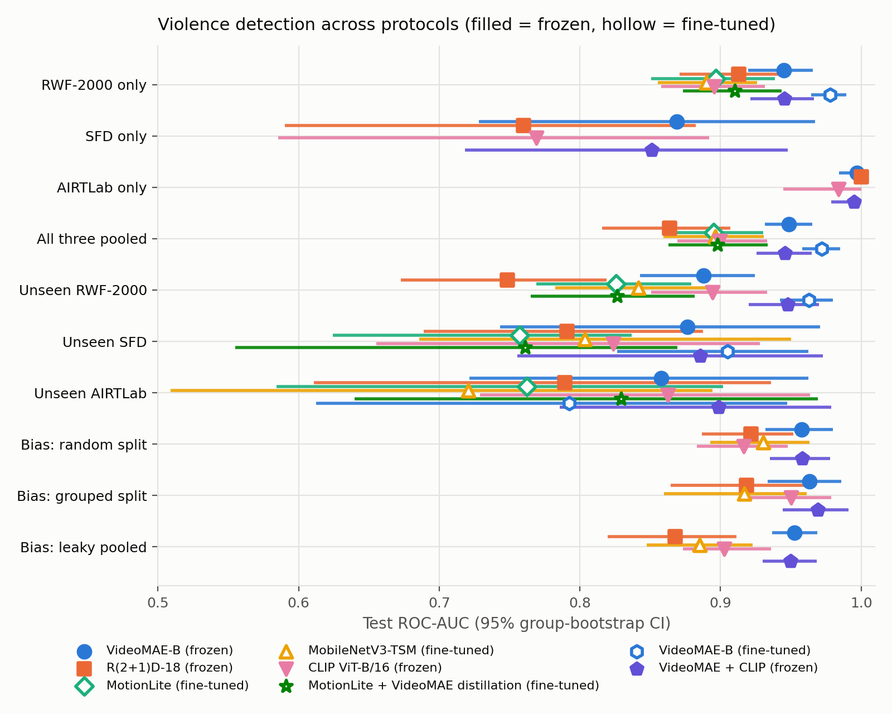
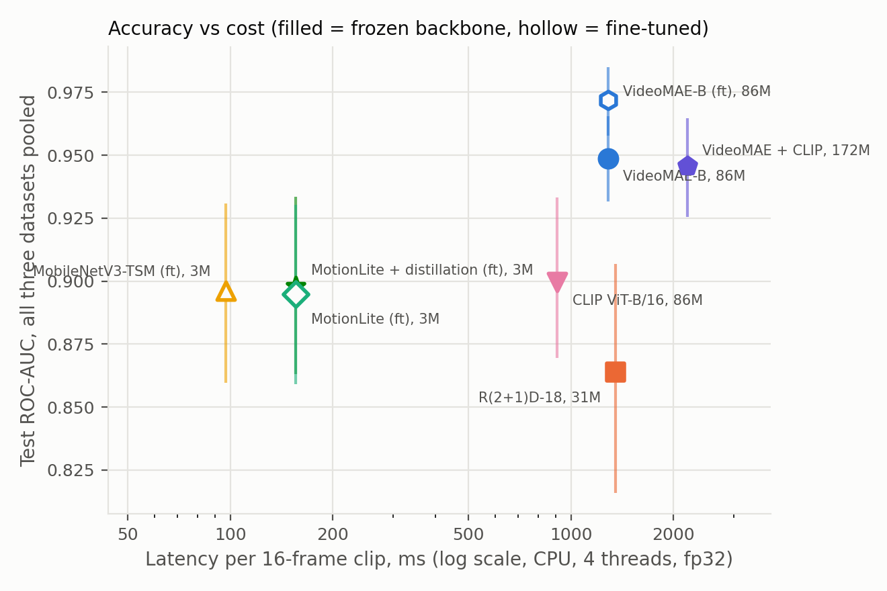

# Suraksha-Net

**Leakage-free violence detection in surveillance video, with a live CCTV monitor.**

*Suraksha* means "safety" in Hindi. Suraksha-Net audits three public violence-detection datasets for
duplicate and shared-source clips, evaluates models on splits where no source video crosses the
train/test boundary, compares large pretrained video models with a 3-million-parameter network that
runs on a CPU, and ships the small model inside a web-based live monitor.

Major Project I, Department of CSE & IT, Jaypee University of Information Technology, AY 2026-27.

## Headline results

All numbers are test-set results with the decision threshold chosen on validation data only.
Confidence intervals come from a group bootstrap (whole source groups are resampled).

| Result | Value |
|---|---|
| Fine-tuned VideoMAE-B, all three datasets pooled | ROC-AUC **0.972**, accuracy 91.2% (3 runs) |
| Same model, trained only on SFD + AIRTLab, tested on RWF-2000 | ROC-AUC **0.963** |
| Frozen VideoMAE + CLIP probe, mean over the three unseen datasets | ROC-AUC **0.911** |
| MotionLite (3.0 M parameters) versus VideoMAE-B (86.2 M) on a CPU | **156 ms** versus 1,286 ms per 16-frame clip (about 8 times faster) |
| Knowledge distillation, unseen AIRTLab | ROC-AUC 0.762 to **0.829** (+0.067); confidence intervals overlap |
| Dataset audit | 11 exact duplicate files in RWF-2000; 10 YouTube source videos shared by RWF-2000 and SFD (57 RWF-2000 clips); 1,122 source groups in 2,650 clips |
| Split leakage | Random and group-aware splits gave similar scores here; the shift between datasets mattered much more |



## What it does

1. **Audits the data.** SHA-256 hashes, container metadata and a full decode check for every clip,
   perceptual-hash near-duplicate search, and source-video matching across datasets.
2. **Builds clean splits.** Union-find merges duplicates, near-duplicates, same-source videos and
   AIRTLab camera pairs into source groups. A group never crosses train, validation and test.
   Ten protocols are built and hash-locked (`work/splits/LOCK.json`).
3. **Compares three families of models.** Frozen foundation models with linear probes (VideoMAE-B,
   CLIP ViT-B/16, R(2+1)D-18), a partially fine-tuned VideoMAE-B, and lightweight networks
   (MobileNetV3-TSM and **MotionLite**), with and without knowledge distillation.
4. **Reports honestly.** Validation-only threshold and checkpoint selection, several seeds where
   possible, group-bootstrap confidence intervals, calibration error, and CPU and GPU latency.
5. **Runs live.** A FastAPI web app reads a webcam, an RTSP stream or a recording, scores the last four
   seconds of video every second with the distilled MotionLite model, and raises alerts with snapshots
   into a review queue.

## Models

| Model | Parameters | CPU ms / clip | Pooled ROC-AUC | Mean ROC-AUC on unseen datasets |
|---|---:|---:|---:|---:|
| VideoMAE-B, partially fine-tuned (last 4 of 12 blocks) | 86.2 M | 1,286 | 0.972 | 0.887 |
| VideoMAE-B, frozen probe | 86.2 M | 1,286 | 0.949 | 0.874 |
| VideoMAE + CLIP, frozen probe | 172 M | n/a | 0.946 | 0.911 |
| CLIP ViT-B/16, frozen probe | 86.2 M | 911 | 0.900 | 0.860 |
| R(2+1)D-18, frozen probe | 31.3 M | 1,353 | 0.864 | 0.776 |
| MobileNetV3-TSM, fine-tuned | 3.0 M | 97 | 0.896 | 0.789 |
| MotionLite, fine-tuned | 3.0 M | 156 | 0.895 | 0.782 |
| MotionLite + distillation from VideoMAE | 3.0 M | 156 | 0.898 | 0.805 |

CPU latency: one 16-frame clip, 4 threads, fp32. "Unseen" means leave-one-dataset-out: train on two
datasets, test on the third. Per-protocol tables with confidence intervals are in
[`work/results/summary.md`](work/results/summary.md).

**MotionLite** takes 16 frames at 224 x 224. An RGB stream and a frame-difference stream, each a
MobileNetV3 stem with temporal shift, are fused by a learned gate (zero-initialised, so training starts
from the RGB features) and pooled over time with attention. It is a recombination of published
ingredients, not a new architecture.



## Protocols

| Group | Protocols | Question |
|---|---|---|
| P1 | `p1_rwf`, `p1_sfd`, `p1_avd` | Within one dataset |
| P2 | `p2_all` | All three datasets pooled |
| P3 | `p3_no_rwf`, `p3_no_sfd`, `p3_no_avd` | Train on two datasets, test on the unseen third |
| P4 | `p4_random`, `p4_grouped`, `p2_all_leaky` | Bias study: random versus group-aware splits, group rule switched off |

Eight protocols are group-disjoint; `p4_random` and `p2_all_leaky` deliberately let groups cross
partitions, as controls.

## Datasets

The datasets are **not** in this repository.

| Dataset | Clips used | Violent / non-violent | Notes |
|---|---:|---|---|
| [RWF-2000](https://github.com/mchengny/RWF2000-Video-Database-for-Violence-Detection) | 1,995 | 997 / 998 | 5 s YouTube surveillance clips; 5 exact duplicates removed. Not redistributable without the authors' approval. |
| [SFD](https://github.com/seymanurakti/fight-detection-surv-dataset) | 300 | 150 / 150 | Surveillance Camera Fight dataset, YouTube CCTV footage |
| [AIRTLab (AVD)](https://github.com/airtlab/A-Dataset-for-Automatic-Violence-Detection-in-Videos) | 350 | 230 / 120 | Staged indoor scenes, two cameras, non-violent actions that look like violence |

Download them yourself (anywhere), then run

```powershell
python -m pipeline fetch --src D:\downloads\rwf --src D:\downloads\sfd --src D:\downloads\airtlab
```

`fetch` identifies each clip by its SHA-256 hash, so the folder layout of a download does not matter:
every manifest clip with a byte-identical file is linked (or copied) to `datasets/public/`, and the
command fails and reports the missing counts if a needed clip is absent. The audit manifest of every
clip and overlap is in `work/manifest/`, and the locked splits are in `work/splits/`, so the
experiments can be reproduced without publishing any footage.

## Quick start

Tested on Windows 11, Python 3.13.2, PyTorch 2.6.0 (CUDA 12.4) and an RTX 4050 laptop GPU with 6 GB.

```powershell
python -m venv .venv
.venv\Scripts\activate
pip install torch torchvision --index-url https://download.pytorch.org/whl/cu124   # or the CPU build
pip install numpy pandas scikit-learn scipy pyyaml pillow matplotlib av transformers pytest
pip install -r demo_app/requirements.txt                 # web app
pip install --target .ml_deps opencv-python-headless     # the live monitor loads OpenCV from .ml_deps
```

Run the tests (128 test cases; they need neither the datasets nor a GPU):

```powershell
python -m pytest
```

## Reproducing the experiments

```powershell
python -m pipeline audit                       # clip manifest: hashes, metadata, decode check
python -m pipeline audit --groups              # near-duplicate search and source groups
python -m pipeline split                       # build and lock the ten protocols
python -m pipeline cache                       # decode every clip once into a frame cache (about 4.7 GB)
python -m pipeline grid --dry-run              # list the runs and estimate GPU time
python -m pipeline grid --grid pipeline/configs/grid_seeds.yaml    # train and evaluate
python -m pipeline probe table                 # rebuild the results table
python -m pipeline figures                     # rebuild the result figures
```

The experiments are described in `pipeline/configs/` (`base.yaml` holds all settings; the `grid_*.yaml`
files list runs). The grid runner skips finished runs and resumes interrupted ones from their last
checkpoint, so a crash does not lose work. Training uses AdamW (weight decay 0.05), a cosine schedule
with two warm-up epochs, label smoothing 0.1, an effective batch of 32, at most 40 epochs and early
stopping after 6 epochs without validation improvement. Distillation uses out-of-fold soft targets from a
frozen VideoMAE probe (five group folds, alpha = 0.5), so no clip's target comes from a model trained
on it. The full run set was 40 probe results and 43 fine-tuned training runs.

## Live monitor and project website

```powershell
python -m uvicorn demo_app.app:app --host 127.0.0.1 --port 8741
```

Open <http://127.0.0.1:8741>. Pick a webcam, a USB camera, an `rtsp://` CCTV stream or a recording,
enter a camera name and location, and press **Start monitoring**.

- **Scoring:** the capture thread keeps the last 4 s of video (15 fps); the scorer thread samples 16
  frames once per second and runs the distilled MotionLite model (about 13 ms per pass on the laptop GPU).
- **Alert rule:** an alert is raised when 3 of the last 5 scores reach the threshold (0.51), at most
  one alert per camera every 20 s. Each alert stores a snapshot and goes into a review queue with the
  states New, Acknowledged, Resolved and False alarm.
- **API:** `/api/live/start`, `/api/live/stop`, `/api/live/status`, `/api/live/stream` (Motion JPEG
  preview), `/api/live/sources` and `/api/alerts`. Set `SURAKSHA_API_KEY` to require an `X-API-Key`
  header on the alert API.
- **Review screen:** `/review` is the original upload-and-review page from the first project phase.

Model checkpoints and videos are not in git (`*.pt`, `*.pth`, `*.onnx`, `*.mp4` are ignored). To use
the monitor, train the distilled MotionLite model on `p2_all` and save the checkpoint as
`demo_app/models/motionlite_kd_p2_all.pt`
(`work/runs/p2_all/motionlite__train.distill_teacher-videomae/seed1/best.pt` after a run).
The monitor has been tested on a recording replayed in real time; it has not yet been tested on a real
webcam or a networked IP camera.

## Repository layout

| Path | Contents |
|---|---|
| `pipeline/` | The research pipeline: audit, splits, frame cache, models, trainer, evaluation, statistics, experiment grid (`python -m pipeline <command>`) |
| `pipeline/configs/` | `base.yaml` and the grid files |
| `pipeline/tests/` | The automated test suite (pytest) |
| `demo_app/` | The live monitor and review screen (FastAPI): `live.py`, `alerts.py`, `cameras.py`, `app.py` |
| `site/` | The project website page (`suraksha_net.html`) |
| `work/manifest/` | Audit of every clip: SHA-256, metadata, near-duplicate pairs, source groups |
| `work/splits/` | The ten locked protocol splits (`LOCK.json` holds their hashes) |
| `work/results/` | Results table and figures |
| `work/probe/`, `work/bench/`, `work/logs/` | Frozen-probe outputs, speed and memory benchmarks, run logs |
| `datasets/metadata/` | Semester split metadata read by the audit |
| `docs/` | Literature review, design document and implementation plan |
| `reports/` | Research-paper-style write-up (`paper_draft.pdf`) and its generator |

Not in git: the datasets, the frame cache, trained checkpoints, pretrained weights and videos
(RWF-2000 footage cannot be redistributed).

## Limitations

- The SFD and AIRTLab test sets are small (47 and 52 clips), so their confidence intervals are wide.
- MobileNetV3-TSM and the frozen probes have one run each; VideoMAE has three seeds and each MotionLite
  variant two.
- All clips are short and trimmed. False alarms per hour on long, continuous footage have not been
  measured, and latency was measured on one laptop only.
- Kinetics-400 pretraining and the violence datasets both draw largely on YouTube, so some source videos
  may overlap, which would favour the Kinetics-pretrained models.

## Roadmap

Deployment on edge hardware (ONNX and TensorRT export, Jetson or Raspberry Pi, a headless monitor);
tuning the alert rule on long recordings of normal activity; a stronger distillation teacher; more
seeds and an ablation of MotionLite's parts; more and larger datasets.

## References

- M. Cheng, K. Cai and M. Li, "RWF-2000: An open large scale video database for violence detection,"
  ICPR 2020, doi: 10.1109/ICPR48806.2021.9412502.
- Ş. Aktı, G. A. Tataroğlu and H. K. Ekenel, "Vision-based fight detection from surveillance cameras,"
  IPTA 2019, doi: 10.1109/IPTA.2019.8936070.
- M. Bianculli et al., "A dataset for automatic violence detection in videos," Data in Brief 33, 2020,
  doi: 10.1016/j.dib.2020.106587.
- Z. Tong et al., "VideoMAE: Masked autoencoders are data-efficient learners for self-supervised video
  pre-training," NeurIPS 2022.
- A. Radford et al., "Learning transferable visual models from natural language supervision," ICML 2021.
- J. Lin, C. Gan and S. Han, "TSM: Temporal shift module for efficient video understanding," ICCV 2019.
- A. Howard et al., "Searching for MobileNetV3," ICCV 2019.
- D. Tran et al., "A closer look at spatiotemporal convolutions for action recognition," CVPR 2018.
- G. Hinton, O. Vinyals and J. Dean, "Distilling the knowledge in a neural network," arXiv:1503.02531, 2015.

The full literature review, with the evaluation protocol behind each published result, is in
[`docs/literature.md`](docs/literature.md).

## Team

Group RG83: Savitoj Saini, Arpit Thakur, Vishnu Bhargava and Ojas Chauhan. Thanks to our supervisor and to
the Department of Computer Science & Engineering and Information Technology, Jaypee University of
Information Technology, Waknaghat. The authors of RWF-2000, SFD and AIRTLab made their data available for
research, and the PyTorch, torchvision, Hugging Face Transformers, scikit-learn, OpenCV and FastAPI
projects made the implementation possible.
